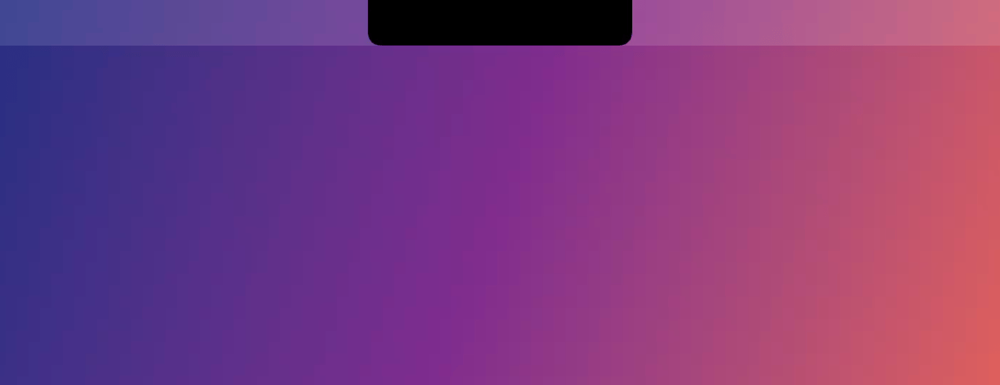

# Isle

The notch that does your waiting for you. Isle is where the things you're
waiting on report back: Claude Code asking for permission (allow it from the
notch), a build finishing, a call about to start, your music. It's black,
quiet, and gone when there's nothing to say.

Native Swift + SwiftUI, Apple silicon, macOS 14 or later, open source. See
[FEATURES.md](FEATURES.md) for everything it does.



Also in [Liquid Glass](docs/demo-glass.gif), and as full-resolution video:
[Black](docs/demo-black.mp4) · [Liquid Glass](docs/demo-glass.mp4).

## Install

1. Download **Isle-x.y.z.zip** from the
   [latest release](https://github.com/abhijitrajbanshi/isle/releases/latest)
   and unzip it.
2. Drag **Isle.app** into **Applications** and open it.
3. macOS will say it can't verify the developer (Isle isn't notarized yet).
   Open **System Settings → Privacy & Security**, scroll down and click
   **Open Anyway**. You only do this once.

Requires an Apple silicon Mac with macOS 14 Sonoma or later.

## Agents and scripts

**Claude Code:** open Isle's Settings → Agents → **Connect**. Isle adds its
hooks to `~/.claude/settings.json` (keeping a backup) and from then on shows
what each session is doing, opens when Claude asks for permission (Allow /
Deny right there), and tells you when it's done. If you don't answer within
45 seconds, Claude asks you as usual; if Isle isn't running, nothing changes.

**Anything else:** the bundled `isle` command reports to the notch.

```bash
alias isle=/Applications/Isle.app/Contents/Helpers/isle
isle run -- make release          # live while it runs, ✓ or ✗ when it ends
isle progress upload 0.42 --title "Uploading" --detail "photos.zip"
isle done upload
```

## Light by design

Isle does nothing until something happens: no polling, no global mouse
monitor, no timers ticking at rest. Measured with `top` over a minute on an
M5 MacBook with macOS 27.2, music showing in the notch:

| | Isle |
|---|---|
| CPU | 0.1 % average |
| Wakeups | under 1 per second |
| Memory | about 35 MB |

Measure it yourself: `top -pid $(pgrep -x Isle) -stats cpu,idlew,power,mem`.

## Build & run

```bash
./scripts/build.sh            # → build/Isle.app
./scripts/build.sh --install  # copy to /Applications and launch
```

Requires Xcode (or the Command Line Tools) with Swift 6.

## First launch

Isle is a menu-bar-less accessory app: look at your notch. macOS will ask for:

* **Calendar** — next event and five-minute reminders
* **Bluetooth** — AirPods / device connect alerts
* **Automation (Music / Spotify)** — only if the system-wide Now Playing
  helper can't see your player

Builds are ad-hoc signed, so macOS may ask again after a rebuild.

## Architecture

```
Sources/IsleKit/            platform-independent core, unit tested
  IslandEngine              state machine: expanded › alert › live activities › idle,
                            alert queueing/coalescing, hover / click / file-drag logic
  IslandLayout              every size derived from the notch's real geometry
  SwipeInterpreter          trackpad deltas → one gesture per swipe
Sources/Isle/
  App/                      composition root (IsleContainer), preferences, settings, menu bar
  Platform/                 click-through NSPanel, pointer / drag / swipe input, screen location
  Island/                   the morphing island: root, compact, alert and expanded content
  DesignSystem/             motion and colour tokens, notch shape, shared components
  Features/<Name>/          one folder per feature: @Observable model + system integration + views
  Snapshots/                offscreen renderer for design review
Tests/IsleKitTests/         Swift Testing suite for the engine, layout and gestures
```

Swift 6 language mode with complete concurrency checking. Models are
`@Observable` and main-actor isolated; slow work (Apple Events, artwork
colour extraction, device queries, bridge decoding) runs off the main actor.
Timing uses Swift concurrency tasks, so the engine is testable with an
injected sleep.

```bash
swift test                                   # IsleKit engine tests + app feature tests
.build/debug/Isle --snapshots ./snapshots    # render every island state to PNG
build/Isle.app/Contents/MacOS/Isle --demo black  # play the showcase tour in a window, to record (or glass)
```

## Release

```bash
git tag -a v1.2.0 -m "Isle 1.2.0" && git push origin main v1.2.0
./scripts/build.sh --release   # tests → build → sign → build/Isle-1.2.0.zip + build/appcast.xml
gh release create v1.2.0 build/Isle-1.2.0.zip build/appcast.xml --title "Isle 1.2.0" --notes-file … --latest
```

**Always attach `appcast.xml` next to the zip.** Installed copies check
`releases/latest/download/appcast.xml` once a day (Sparkle); a release without
it is invisible to them.

* **Version** comes from the latest git tag (`v1.2.0` → 1.2.0); the build number is the commit count.
* **Signing:** set `SIGN_IDENTITY="Developer ID Application: …"` for a hardened-runtime
  signature with `Resources/Isle.entitlements`. Without it, builds are ad-hoc signed.
* **Notarization:** also set `NOTARY_PROFILE` (saved with `xcrun notarytool store-credentials`)
  and the zip is notarized and stapled.
* **Auto-updates** are signed with a Sparkle EdDSA key in the login keychain
  (account `isle`); `Info.plist` carries its public half (`SUPublicEDKey`), and
  installed copies reject any update not signed with it. **Back the key up**:
  `.build/artifacts/sparkle/Sparkle/bin/generate_keys --account isle -x isle-sparkle.key`,
  store the file somewhere safe (a password manager), and delete it locally. Losing
  it means existing installs can never be updated again.
* **CI** (`.github/workflows/ci.yml`) runs tests, builds the app, and uploads the
  app and the rendered island states on every push and pull request.

## Diagnostics

Lifecycle events and errors (never per-track data) go to the unified log
(subsystem `com.avhiejeet.Isle`) and to `~/Library/Logs/Isle.log`, which rotates at 512 KB.

## Energy

Isle is event-driven: no global mouse monitoring, no polling for
camera/microphone, calendar or players, and the waveform animates in the window
server. At rest it measures 0.0% CPU and an energy impact of 0.0. Decorative
motion holds still under Low Power Mode and Reduce Motion.

## How Now Playing works

macOS 15.4 restricted MediaRemote (the system Now Playing service) to
Apple-signed processes. Isle loads a small bridge library into the Apple-signed
`/usr/bin/perl`, which streams track info as JSON and accepts play/pause, skip
and seek commands. If the bridge can't see a player, Isle falls back to
AppleScript for Music and Spotify. You can turn the bridge off in
Settings → Live Activities → "Include browsers and all other apps".
